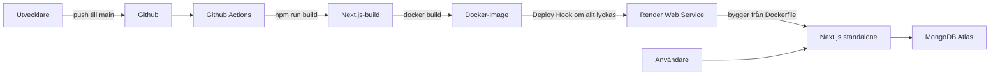

## App

Applikationen är en enkel anteckningsapp byggd med Next.js, TypeScript och MongoDB. Appen har två sidor, en sida för anteckningslistan och en sida för den enskilda anteckningen. Applikationen ger användaren möjligheten att skapa, radera, uppdatera och läsa anteckningarna. Applikationen består alltså av en enkel CRUD.

## Ramverk

Applikationen använder sig av Next.js. Ramverket valdes av olika anledningar dels då den har support för client och server-side rendering vilket gör det enkelt att arbeta med. Next.js ramverket låter även oss sätta upp ett fullstack projekt utan att behöva skapa en separat backend med exempelvis en express server. Detta gör uppsättningen och konfigurationen enklare och smidigare. Vi behöver dessutom endast driftsätta/ deploya en enda container.

## Instruktioner lokalt

Vid start lokalt se till att köra:

- git clone https://github.com/Leon-Noyan/Notesapp
- cd Notesapp
- npm install
- Skapa .env.local för att konfigurera miljövariabel enligt .env.example MONGO_URI="mongodb+srv://<username>:<password>@cluster0.abcde.mongodb.net/notes_dev?retryWrites=true&w=majority"

- Starta utvecklingsservern: npm run dev
- Öppna http://localhost:3000

Notera att projektet använder node.js version 26.

## Instruktioner Docker-container

Dockerfile är multi-stage för att optimera bildstorleken. Beroendena installeras och Next.js byggs med standalone stöd. Sista steget kör node server.js med node. Container lyssnar sedan på 0.0.0.0:3000 via miljövariablerna HOSTNAME OCH PORT som Render behöver.

Utgå från dessa steg för att bygga och köra applikationen i en isolerad docker-container.

- Se till så att du har Docker installerat, starta sedan Docker.
- Skapa en env fil om du ska skicka miljövariabel via en fil istället för terminalen.
- Kör: docker build -t notesapp .
- docker run -p 3000:3000 -e MONGO_URI="din_anslutningsstrang_här" notesapp
- Alternativt med env-fil: docker run --rm -p 3000:3000 --env-file .env notesapp
- öppna http://localhost:3000
- Health check: http://localhost:3000/health

## Miljövariabler & hemlighetshantering

Projektet använder sig av miljö variabler för att hantera konfiguration och skilja på utvecklingsmiljö och produktionsmiljö:

Utvecklingsmiljön (Lokalt): Styrs av .env.local och startas med npm run dev. Den använder samma variabel namn (MONGO_URI) som produktion men pekar mot en annan databas nämligen notes_dev. Detta för att inte lägga till massa test data från utvecklingen till live servern.

Produktionsmiljön (Render): Även här används MONGO_URI men värdet konfigureras säkert via Render Dashboard och pekar mot produktionsdatabasen (notes). Containern körs med NODE_ENV=production.

Hemligheter: Känsliga uppgifter hårdkodas inte utan Github actions använder endast RENDER_DEPLOY_HOOK_URL som secret för att starta driftsättningen. Env filer ignoreras även via .gitignore.

## Loggning & health

Projektet använder loggning, detta då de ger oss värdefull information kring applikationen. Med loggar kan vi på ett enklare sätt se vad och när saker går fel. Utan denna information hade det varit svårt att felsöka när något inte fungerar.

- Start: instrumentation.ts loggar INFO: Server started vid uppstart.
- Health Check: GET/ health returnerar status 'ok'. Detta verkar som en enkel kontroll för att visa att appen svarar.
- Databas & fel: mongodb.ts loggar anslutningstatusen med INFO: samt fel med ERROR vid anslutningsfel eller vid felaktiga miljövariabler.
- Alla loggar visas även i Render under fliken Logs.

Länk till Health enpoint: https://notesapp-qrxr.onrender.com/health

## Github actions

Trigger

- Pipeline triggas igång när kod pushas till main branchen
  Miljövariabler (env)
- Github actions hämtar hemliga nycklar från Github repository secrets ( `RENDER_DEPLOY_HOOK_URL`).
  Steps
- Checkout code hämtar den senaste koden från Github repot
- Set up node: Sätter upp node versionen och caching för paketinstallation.
  Install dependencies: Hanterar nedladdning av projektets beroenden genom npm ci.
  Build Next.js application: Bygger själva next.js appen för att undvika kompilering och byggfel i koden.
  Build Docker image: Bygger en lokal docker image utifrån Dockerfile för att testa container.
  Trigger Render Deploy Hook: När allt har lyckats så skickas curl förfrågan till Render Deploy Hook-URL som uppdaterar live appen i Render. Skulle build misslyckas så kommer jobbet inte köras utan Hook stoppas.

## Render-driftsättning

- Actions verifierar npm run build och docker build.
- Deploy Hook anropas vid lycka.
- Nu kan Render hämta koden och bygga image från Dockerfile.
- MONGO_URI tas från Render Dashboard och appen lyssnar på 0.0.0.0:3000 HOSTNAME / PORT i Dockerfile
- Notera att auto deploy är avstängt i Render, Github actions styr alltså när driftsättningen ska ske.

## Kostnadsmedveten drift

Projektet använder Renders free tier vilket gör att det inte kostar något.
Projektet använder även MongoDb Atlas molnbaserade cluster för databasen vilket även är gratis. Detta går dock att uppgradera ifall projektet skulle växa och det skulle visa sig nödvändigt då både Render och MongoDB Atlas har betalda versioner.

## Länkar

https://notesapp-qrxr.onrender.com/
https://github.com/Leon-Noyan/Notesapp
https://notesapp-qrxr.onrender.com/health

## Arkitekturdiagram & Tekniska val

Som tidigare nämt valdes Next.js som ramverk då den har support för både client och serverside rendering vilket gör den enklare att arbeta med samtidigt som den erbjuder god prestanda. Eftersom den kör både UI och API så behöver vi även endast driftsätta en container.

MongoDB Atlas används som databas för projektet. Detta är ett mindre projekt med en enklare struktur. Därmed kändes den mer passande än en SQL databas då vi inte arbetar med komplexa relationer. Eftersom projektet använder MongoDB som databas behövs inte en databasprocess för containern. Anslutningen sker via MONGO_URI som miljövariabel och exponeras inte i webbläsaren.

## Frågor & Svar

Vilken Render-plan använder du?

Jag använder free tier planen.

Varför har du valt den?

Jag valde free planen då den är tillräcklig för ett litet skol projekt. Sidan har inte någon hög trafik för att uppgradera till en högre plan med starkare CPU.

Vilka faktorer påverkar kostnaden för att driva applikationen?

Det finns flera faktorer som kan påverka, exempel kan vara hur mycket trafik webbsidan har. Trafiken påverkar mängden bandwidth som platformen kräver, CPU och RAM är även stora faktorer. Här behöver vi kika på hur mycket dator kraft servern behöver för att rulla smidigt. Vill man att servern ska hålla sig vaken i render så kostar det också då servern i gratisversionen endast går igång när man besöker den.

Hur kan du minska applikationens resursanvändning?

Vi kan använda standalone vilket gör Docker image mindre vilket i sig minskar mängden RAM som behövs. Vi kan även använda cache för att minska den mängd databas anrop som sker. Ytterligare en sak vi kan göra är att optimera koden med server components samt hur vi gör databas anrop.

Vilka begränsningar har din nuvarande driftlösning?

Den nuvarande driftlösningen orsakar att servern sover och endast startar vid besök. Detta beteende är inget vi egentligen vill ha vid ett verkligt projekt med riktiga användare. Den är heller inte kraftfull när det gäller saker som CPU, det räcker dock för ett skoltprojekt. En annan begränsning kan vara Render i sig eftersom vi använder Renders server så är det en server vi lånar/ hyr. Detta innebär att vi inte har full frihet att sätta upp servern exakt hur som helst.

Vad skulle du behöva förändra om applikationen fick betydligt fler användare?

Om applikationen fick fler användare skulle jag behöva uppgradera planen. Innan jag uppgraderar hade jag dock monitorerat för att se vilken plan som hade passat bäst så att jag inte överskjuter. Utöver att uppgradera planen vilket klassas som att göra en vertikal scaling så hade jag även kunnat kika på horisontell scaling. Med horisontell scaling menar man att man kör serverinstanser eller containers parallelt. Man hade exempelvis kunnat kika på load balancer för att fördela trafiken jämnt mellan noderna samt flytta trafiken från de noder som inte fungerar som de ska.
